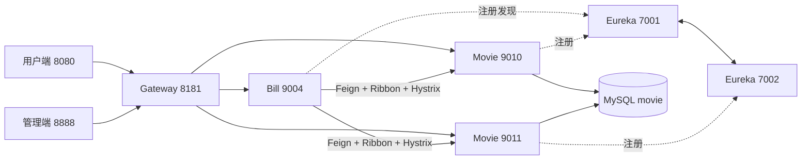
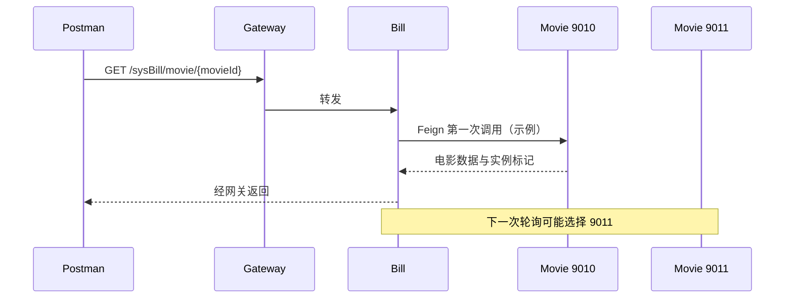
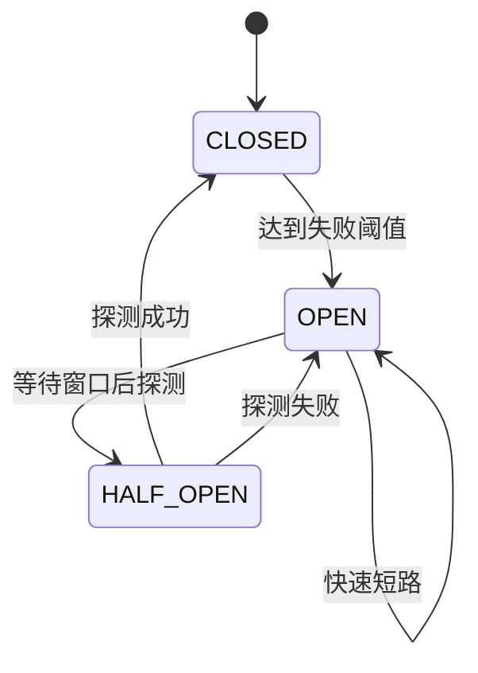
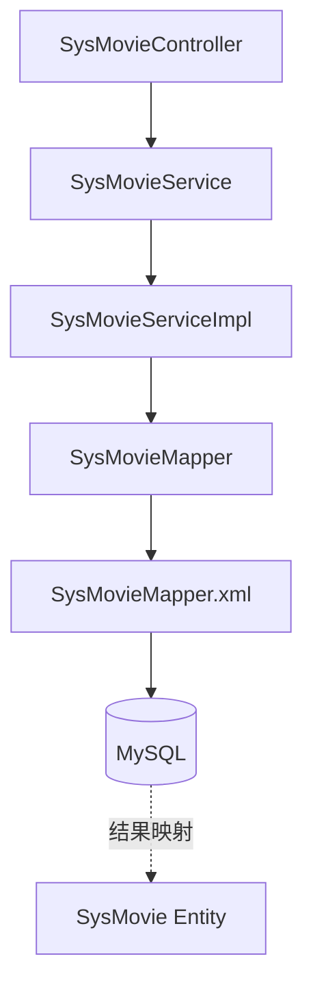

# 狗眼电影在线售票微服务系统｜现场答辩操作指导书

> Windows 实操版。以下命令以仓库根目录的 Git Bash 为准；标为 PowerShell 的步骤在 Windows PowerShell 中执行。演练结果见文末。

## 现场操作导航

| 顺序 | 演示 | 打开位置 | 核心证据 |

| --- | --- | --- | --- |

| 1 | 业务页面 | 8080、8888 | 电影列表与后台 |

| 2 | Eureka | 7001、7002 | UP、双实例、peer |

| 3 | Ribbon | 终端、Postman | 六次 servedBy |

| 4 | OpenFeign | IDEA、Postman | Bill → Movie 真实响应 |

| 5 | Hystrix | 终端、Postman | 超时、OPEN、CLOSED |

| 6 | Gateway | IDEA、Postman | 8181 业务请求 |

| 7 | 分层 | IDEA | Controller → Service → Mapper |

| 8 | MyBatis | 后台、MySQL | CRUD 前后数据 |

> 建议先完成所有正常模式演示，再集中切换 Hystrix；如果老师要求原顺序，则按正文执行并恢复正常模式。

## 系统架构示意



## 工具参考与截图说明

- [IDEA Search Everywhere 官方图文](https://www.jetbrains.com/help/idea/searching-everywhere.html)
- [Chrome Network 官方图文](https://developer.chrome.com/docs/devtools/network/)
- [Postman 请求官方图文](https://learning.postman.com/docs/sending-requests/requests/)
- [Spring Cloud Netflix Hoxton 文档](https://cloud.spring.io/spring-cloud-netflix/reference/html/)
- [MyBatis XML 官方文档](https://mybatis.org/mybatis-3/sqlmap-xml.html)

以上是外部参考入口，未在本次逐一联网核验；不作为本项目实测证据。

狗眼电影在线售票微服务系统

现场答辩逐文件操作手册

适用项目：hanyuye1306-art/cinema-ticketing-microservices

版本依据为本机 master 的 03c0f51 及本次修复，运行结果以本机 2026-11-25 验证记录为准。

使用方式：答辩前按“准备清单”完成检查；答辩时按本手册顺序操作。凡标注“现场确认”的内容，必须以本机 IDEA 中的真实代码、实际响应为准，不要背诵未经核实的 URL、JSON 字段或端口。

## 一、答辩前先明确的项目事实

本项目后端位于 gouyan-cloud，前端位于 gouyan-web。公开验收记录列出的正常运行端口为：Eureka 7001/7002、Gateway 8181、用户端 8080、管理端 8888；业务服务包括 Actor 9000、Auth 9002、Bill 9004、Cinema 9006、Hall 9009、Movie 9010/9011、Admin 8183。

| 课程要求 | 本项目对应实现/证据 | 答辩时展示重点 |
| --- | --- | --- |
| Eureka 双节点高可用 | gouyan-eureka；7001、7002；peer1/peer2 配置 | 两个 Dashboard、注册服务列表、节点互为 peer |
| Ribbon 客户端负载均衡 | Bill 的 RoundRobinRule；Movie 9010/9011 | 六次响应的 servedBy 交替 |
| OpenFeign | MovieFeignClient；Bill 调用 Movie | FeignClient 接口与真实电影查询响应 |
| Hystrix 熔断 | BillMovieQueryServiceImpl、FallbackFactory、状态控制器 | 超时、OPEN 快速短路、恢复 CLOSED |
| Gateway | gouyan-gateway/application.yml | 8181 统一入口、路由规则 |
| 服务提供者分层 | Controller、Service、Mapper、Entity 等 | 沿电影或账单业务链路展示 |
| MyBatis 单实体操作 | gouyan-system 的 SysMovie、SysMovieMapper、XML | 管理后台影片 CRUD 与数据库结果 |

重要说明：项目采用 Spring Boot 2.3.2.RELEASE、Spring Cloud Hoxton.SR7，是较早期 Spring Cloud Netflix 技术组合。答辩时按项目实际依赖讲，不要把它说成 Spring Cloud LoadBalancer 或 Resilience4j。

DAO 与 Mapper 的关系：本项目目录明确有 mapper 包，Mapper 接口承担 MyBatis 数据访问职责。若老师把 DAO 与 Mapper 分别列为要求，可以解释“Mapper 是本项目的数据访问对象接口/DAO 实现形式”，不要虚构一个不存在的独立 DAO 层。

## 二、答辩前准备

本机已安装 Git for Windows、Java 11.0.33、Maven 3.9.9、MySQL 8.1、Node 18.13.0、npm 9.9.4、Python 3.9.13。打开 Git Bash，进入项目根目录。

```bash
cd /c/Users/lenovo/cinema-ticketing-microservices
pwd
git branch --show-current
git rev-parse --short HEAD
java -version
mvn -v
mysql --version
node -v
npm -v
python --version
```

本机 MySQL Windows 服务名是 `MySQL81`。在 PowerShell 执行 `Get-Service MySQL81`，应为 `Running`。若已停止，在管理员 PowerShell 执行 `Start-Service MySQL81`。已有 `movie` 库可直接演练。

把下列命令逐行输入同一 Git Bash。只在当前 shell 设置变量，输入时终端不回显。若本机已经设置 `MYSQL_PASSWORD`，只执行管理员密码两行。MySQL 与网站各用自己的密码。

```bash
read -rsp 'MySQL root password: ' MYSQL_PASSWORD; printf '\n'
export MYSQL_PASSWORD
read -rsp 'Website admin password: ' GOUYAN_PASSWORD; printf '\n'
export GOUYAN_USERNAME=admin GOUYAN_PASSWORD
```

本机 `admin` 的密码已修改。浏览器和 Postman 使用同一个实际管理员密码。如果有单独的购票用户账号，可在 8080 使用该账号做只读浏览。使用 Chrome/Edge 和 IDEA，准备下节所列页面与代码；Postman 范例见第六节。

## 三、启动、检查与停止

### 3.1 首次初始化（仅空库）

在 Git Bash 先查表，已有 `sys_movie` 则进入下一节。若 MySQL root 没有密码，去掉下面的 `-p`。

```bash
mysql -h 127.0.0.1 -P 3306 -uroot -p movie -e "SHOW TABLES LIKE 'sys_movie';"
```

只有新机器还没有 `movie` 库时才执行以下命令。仓库的初始化文件为 `sql2023/movie.sql`。

```bash
mysql -h 127.0.0.1 -P 3306 -uroot -p -e "CREATE DATABASE movie CHARACTER SET utf8mb4 COLLATE utf8mb4_general_ci;"
mysql -h 127.0.0.1 -P 3306 -uroot -p movie < sql2023/movie.sql
mysql -h 127.0.0.1 -P 3306 -uroot -p movie -e "SHOW TABLES LIKE 'sys_movie';"
```

### 3.2 启动与正常冒烟

首次启动、更新前端锁文件或缺少 `node_modules` 时安装前端依赖。两个目录各有独立锁文件。已有依赖就跳过下面两条。

```bash
(cd gouyan-web/gouyan-user && npm ci)
(cd gouyan-web/gouyan-ui && npm ci)
```

在答辩前完成启动。首次或修改 Java 后可运行 `(cd gouyan-cloud && mvn -B install)`，同时执行 Maven 测试并安装各模块；然后加 `--skip-build` 启动。也可以用以下默认命令，它会先执行 `mvn install -DskipTests`。本机完整冷启动包含多个 JVM 和两个 Vue 编译过程，答辩前至少预留约 10 分钟。

```bash
bash scripts/start-all.sh
bash scripts/status.sh
set -o pipefail
bash scripts/smoke-test.sh --wait 2>&1 | tee .runtime/defense-normal.txt
```

已完成构建且 Java 代码未变时可用 `bash scripts/start-all.sh --skip-build`。状态表的 **UP** 表示端口监听；前端应再等启动日志的 **[READY]**。冒烟脚本通过 `--wait` 等待注册、网关登录路由与前端，并校验两个 Eureka 节点和两个 Movie 实例均为 UP、六次 Ribbon 交替及两个主页 HTTP 200。看到“全系统只读集成回归通过”后开始答辩。

在 PowerShell 可执行下列命令打开浏览器页面。

```powershell
Start-Process 'http://127.0.0.1:8080/'
Start-Process 'http://127.0.0.1:8888/welcome'
Start-Process 'http://127.0.0.1:7001/'
Start-Process 'http://127.0.0.1:7002/'
```

推荐终端 A 启停，终端 B 跟踪日志，终端 C 发请求。需要账号变量的冒烟命令在已设置变量的终端运行，或在新终端重新输入。Windows 的标准输出与错误分别在 `.runtime/<服务名>.log` 和 `.runtime/<服务名>.log.stderr`，启动器错误另见 `.runtime/<服务名>.launch.log`。

### 3.3 停止项目

```bash
bash scripts/stop-all.sh
```

也可指定服务名，例如 `bash scripts/stop-all.sh bill movie-a`。Windows 脚本按仓库路径核对进程归属；遇到无法核对的端口占用会报告 PID。

## 四、IDEA 预打开文件清单

| 顺序 | 文件/目录（相对仓库根目录） | 定位时要找的代码 |
| --- | --- | --- |
| 1 | gouyan-cloud/gouyan-eureka/src/main/java/com/example/gouyaneureka/GouyanEurekaApplication.java | 启动类、@EnableEurekaServer |
| 2 | gouyan-cloud/gouyan-eureka/src/main/resources/application.yml、application-peer1.yml、application-peer2.yml | server.port、defaultZone、peer1/peer2、register-with-eureka、fetch-registry |
| 3 | gouyan-cloud/gouyan-bill/src/main/java/com/gouyan/web/controller/bill/service/impl/BillMovieQueryServiceImpl.java | 调用 MovieFeignClient 的业务方法、Ribbon/Hystrix 相关调用 |
| 4 | gouyan-cloud/gouyan-bill/src/main/java/com/gouyan/web/controller/bill/client/MovieFeignClient.java | @FeignClient、映射注解、服务名 |
| 5 | gouyan-cloud/gouyan-bill/src/main/resources/application.yml | Ribbon 策略、Feign/Hystrix 开关和超时配置（具体键名以本地文件为准） |
| 6 | gouyan-cloud/gouyan-bill/src/main/resources/application-hystrix-demo.yml | 演示 profile 的超时/熔断阈值 |
| 7 | gouyan-cloud/gouyan-bill/src/main/java/com/gouyan/web/controller/bill/fallback/MovieFeignFallbackFactory.java | 降级方法、fallback 标记和异常原因 |
| 8 | gouyan-cloud/gouyan-gateway/src/main/resources/application.yml | Gateway routes、uri、predicates、filters |
| 9 | gouyan-cloud/gouyan-gateway/src/main/java/com/example/gouyangateway/config/RateLimiterConfiguration.java | 按来源 IP 取键的限流辅助 Bean |
| 10 | gouyan-cloud/gouyan-movie/src/main/java/com/gouyan/web/controller/movie/SysMovieController.java | 电影接口映射、参数、调用 Service |
| 11 | gouyan-cloud/gouyan-system/src/main/java/com/gouyan/system/service/SysMovieService.java 与 service/impl/SysMovieServiceImpl.java | Service 接口、业务实现、调用 Mapper |
| 12 | gouyan-cloud/gouyan-system/src/main/java/com/gouyan/system/domin/SysMovie.java | 电影实体字段；目录名 domin 是仓库当前拼写 |
| 13 | gouyan-cloud/gouyan-system/src/main/java/com/gouyan/system/mapper/SysMovieMapper.java | Mapper 方法签名 |
| 14 | gouyan-cloud/gouyan-system/src/main/resources/mapper/SysMovieMapper.xml | SQL、resultMap、insert/select/update/delete |
| 15 | gouyan-cloud/gouyan-bill/src/main/java/com/gouyan/web/controller/bill/SysBillController.java | Bill → Movie 请求入口 /sysBill/movie/{movieId} |

在 IDEA 双击 Shift 搜索文件名，以上表中的模块路径区分重名文件。Hystrix 状态控制器为 `gouyan-cloud/gouyan-bill/src/main/java/com/gouyan/web/controller/bill/HystrixStatusController.java`。

#### IDEA 实际点击方法

打开 IDEA → File → Open → 选择仓库下 gouyan-cloud 的 pom.xml 或目录 → Open as Project → Trust Project（仅已确认自己的仓库）。等待 Maven 导入。双击 Shift，输入表中的完整文件名，若重名则看路径，选择相应模块后回车。Windows Ctrl+F、macOS Command+F 在当前文件搜索关键字；Ctrl/Command+B 跳到声明；Ctrl+Alt+B 或 macOS Command+Option+B 跳到实现。若快捷键被修改，右键 Go To → Implementation(s)。

## 五、正式答辩逐步演示（建议 10—12 分钟）

### 步骤 1：系统业务页面（约 1 分钟）

用户端 [8080](http://127.0.0.1:8080/) 和管理端 [8888/welcome](http://127.0.0.1:8888/welcome) 均需登录。分别在两个标签页完成滑动拼图。用户端先展示首页、电影列表和电影详情；管理员登录后展示后台欢迎页及 [电影信息](http://127.0.0.1:8888/movie)。

> 现场讲解：老师好，首先展示系统的业务界面。用户端用于浏览电影、查看影院与场次、选座和订单操作；管理端用于维护电影、影院、影厅、场次和用户等数据。接下来我从业务页面切换到后端架构，说明这些功能如何由微服务协同完成。

#### 现场照做：浏览器业务界面

用户端 8080 的按钮为 **验证并登录**。登录后点击电影海报进入详情，展示片名、简介或购票入口。管理端按钮为 **点击登录**，输入实际管理员密码，再把拼图滑块拖到缺口位置。欢迎页展示统计；同一登录标签在左侧进入 **电影管理 → 电影信息**，也可直接访问 `http://127.0.0.1:8888/movie`。管理端登录状态保存在当前标签，另开独立标签可能需要登录。

注意：不要在答辩一开始就执行支付。先用只读页面建立业务背景；写操作留到 MyBatis CRUD 环节。

### 步骤 2：Eureka 注册中心与双节点集群（约 1 分钟）

浏览器依次打开 [Eureka 7001](http://127.0.0.1:7001/) 和 [Eureka 7002](http://127.0.0.1:7002/)。在 **Instances currently registered with Eureka** 查看各服务及实例状态。两页分别应显示 `gouyan-movie:9010` 和 `gouyan-movie:9011` 为 UP。

IDEA 操作：Search Everywhere 搜索 GouyanEurekaApplication.java，打开启动类；再打开 gouyan-eureka 下 application.yml / peer 配置，定位端口 7001、7002 和彼此的 defaultZone/peer 配置。然后打开一个业务服务 application.yml，指出它作为 Eureka Client 注册到注册中心的配置。

> 现场讲解：第一项是 Eureka 服务注册与发现。本项目部署了两个 Eureka Server 节点，分别使用 7001 和 7002 端口。微服务启动后会向注册中心注册服务名和实例地址，并通过心跳机制续约。现在两个 Dashboard 都能看到已注册的服务实例。两个节点通过 Peer 配置同步注册信息，降低单点故障风险。

可在演练时单独执行 `bash scripts/stop-all.sh eureka-peer1`。刷新 [7002](http://127.0.0.1:7002/)，检查 Movie 两实例仍 UP，并用 Postman 重发网关电影列表和 Bill 电影查询。记录响应后，用 `bash scripts/start-all.sh --skip-build` 恢复 7001，待两个节点注册齐全后重跑正常冒烟。若刚从旧版脚本迁移且提示 Bill 或 Movie 模式无法确认，先按第 5 节的恢复步骤重新启动这两个实例。

#### 现场照做：注册表验证

两个标签分别打开 7001、7002，Ctrl+F（Mac Command+F）搜索 GOUYAN-MOVIE，确认两个实例端口为 9010 和 9011，状态 UP；再找 GOUYAN-BILL 与 CLOUD-GATEWAY。浏览器另开 http://127.0.0.1:7001/eureka/apps 和 http://127.0.0.1:7002/eureka/apps 可看注册表原始数据。

终端 C：

```bash
curl -fsS -H 'Accept: application/json' http://127.0.0.1:7001/eureka/apps
curl -fsS -H 'Accept: application/json' http://127.0.0.1:7002/eureka/apps
```

看到 application、instance、status 等字段；把两个 Dashboard 与实例状态截图。双节点注册正常不代表已做过节点故障切换。

### 步骤 3：Ribbon 负载均衡（约 1 分钟）



目标：证明 Bill 调用 Movie 时不是固定访问某一个实例，而是从 Eureka 获取实例并按轮询策略选择。验收报告记录 Movie 两实例为 9010/9011，Bill 使用 RoundRobinRule，连续六次调用严格交替。

IDEA 操作：打开 Bill 的 application.yml，定位 Ribbon 客户端配置和 RoundRobinRule；打开 BillMovieQueryServiceImpl.java，找到调用电影服务的业务方法；再打开 MovieFeignClient.java，确认服务名调用。

终端辅助观察。

```bash
tail -f .runtime/bill.log
# 在其他终端分别观察两份 Movie 日志
tail -f .runtime/movie-a.log
tail -f .runtime/movie-b.log
```

请求方式：连续发送 6 次 GET /sysBill/movie/{movieId}（经 Gateway 8181），或运行 smoke-test.sh。普通 /sysMovie 查询只用于获取电影 ID 和验证 Gateway，不能证明 Bill 的 Ribbon 轮询。结合响应 servedBy、脚本输出及实际日志判断。

> 现场讲解：第二项是 Ribbon 客户端负载均衡。Movie 服务运行两个实例，分别为 9010 和 9011。Bill 调用电影服务时，Ribbon 从 Eureka 获取可用实例，再按 RoundRobinRule 轮询选择。验收时连续发起六次调用，可以从实例日志看到请求在两个节点之间交替。

#### 现场照做：六次轮询的确定证据

终端 C 执行：

```bash
set -o pipefail
bash scripts/smoke-test.sh --wait 2>&1 | tee .runtime/defense-normal.txt
```

找 [PASS] Feign 调用 1 至 6，以及 [PASS] Ribbon 轮询实例。窗口最后应见 Ribbon instances: 2。servedBy 的确切格式看当前响应，两个端口应均出现；验收报告记录交替顺序，起始端口不固定。脚本会断言六次响应均包含同一电影 ID，且 servedBy 严格在 9010 和 9011 之间交替。

```bash
grep -nE 'Feign 调用|Ribbon 轮询实例|Ribbon instances' .runtime/defense-normal.txt
```

如果 Bill/Movie 日志没有逐请求打印实例，直接展示 servedBy 和脚本输出，不要杜撰日志句子。第六章提供手工请求方法。

### 步骤 4：OpenFeign 声明式调用（约 1 分钟）

IDEA 操作：打开 MovieFeignClient.java，指出 @FeignClient 的服务名和方法映射；再打开 BillMovieQueryServiceImpl.java，指出业务方法如何调用该接口。若启动类存在 @EnableFeignClients，也可以补充展示。

Postman 操作：先按第六章登录并取得 data.token，使用 Token 请求头（不加 Bearer）。电影列表 GET /sysMovie 用于取得 movieId；真正的 Feign 演示使用 GET /sysBill/movie/{movieId}。原有 .http 文件可在 IDEA 中运行或按内容手工建立 Postman 请求。

验证重点：展示 Bill 经 Feign 获取到真实电影数据，而非仅仅展示一个接口定义。项目 smoke-test.sh 会验证 Bill 到 Movie 的 Feign 调用。

> 现场讲解：第三项是 OpenFeign。这里通过 MovieFeignClient 定义远程调用接口，Bill 业务层只需要调用 Java 方法，不必手工拼接 HTTP 请求。Feign 根据服务名结合注册发现机制定位 Movie 服务；负载均衡由客户端侧组件协同完成。现在通过电影查询请求和 Bill 调用日志，展示实际调用结果。

#### 现场照做：一次 Feign 请求

使用第六章创建的 Bill Movie GET 请求，点击 Send。响应中看 code=200、电影数据及 servedBy。然后切 IDEA，搜索 MovieFeignClient.java，指向 @FeignClient；打开 BillMovieQueryServiceImpl.java，Ctrl/Command+F 搜索 MovieFeignClient 或其字段名称，指出实际调用语句；再打开 SysBillController.java 搜索 /movie/，显示入口。由 Bill 的入口、调用代码和实际响应组成证据链。

### 步骤 5：Hystrix 超时、熔断与恢复（约 2 分钟）



#### 5.1 切换到 Hystrix 演示模式

在正常冒烟通过且已有构建时，仅重启 Bill 和 Movie 9010。两个前端、网关、Movie 9011 和其他服务可继续运行。

```bash
bash scripts/stop-all.sh bill movie-a &&
  bash scripts/start-all.sh --skip-build --hystrix-demo
```

Movie 9010 的详情请求延迟 1500 ms，Bill 命令 `billMovieQuery` 的超时为 500 ms。演示配置的统计阈值为 5 次、错误比例 50%、熔断探测间隔 3000 ms。

#### 5.2 验证超时、短路和恢复

```bash
set -o pipefail
bash scripts/smoke-test.sh --expect-hystrix --wait 2>&1 | tee .runtime/defense-hystrix.txt
```

必须看到 `Hystrix Timeout`、`Hystrix OPEN` 和 `Hystrix CLOSED` 三行。脚本确认 OPEN 时短路计数确实增加，并等待探测请求返回电影数据再确认 CLOSED。若探测命中慢实例，会再等待一个窗口。输出耗时按本次终端结果讲解。只启动了后端时才给两条命令同时加 `--backend-only`。

如需手动展示，在 Postman 打开 **03 Bill → Movie** 与 **04 Hystrix 状态**。在 Bill 响应中看 `fallback`、`failureType`、`failureMessage`；在状态响应中看 `state`、`cumulativeTimeout`、`cumulativeShortCircuited`。约 3 秒后允许下一次探测，快速切标签以抓到 OPEN。脚本可提供同一轮的完整证据。

#### 5.3 IDEA 代码定位

- BillMovieQueryServiceImpl.java：找到被 Hystrix 包裹的远程调用方法、超时/失败处理。

- FallbackFactory 或 fallback 实现类：指出降级结果如何生成，是否返回 fallback 标记、错误原因。

- Hystrix 状态控制器：指出状态查询接口及其返回字段。不要把普通状态查询接口称作 Hystrix Dashboard。

- application-hystrix-demo.yml：指出演示 profile 的超时、熔断阈值等配置。

> 现场讲解：第四项是 Hystrix 服务熔断。正常调用时，Bill 可以通过 Feign 查询 Movie。现在我切换到故障演示配置，让下游 Movie 响应时间超过 500 毫秒的超时阈值。命中延迟实例的调用会触发超时；达到熔断条件后，熔断器进入 OPEN，后续请求快速失败并执行降级逻辑。等待熔断窗口后，如果探测请求成功，熔断器会恢复 CLOSED。这样可以减少下游故障对上游服务的持续占用和连锁影响。

演示结束后恢复正常模式。

```bash
bash scripts/stop-all.sh bill movie-a &&
  bash scripts/start-all.sh --skip-build &&
  bash scripts/smoke-test.sh --wait
```

恢复后检查六次 Ribbon 交替及两个前端 HTTP 200。需要手工重发请求时，按第六节重新登录更新 Token。

### 步骤 6：Gateway 微服务网关（约 1 分钟）

网关监听 8181。直接在地址栏访问根路径会得到 404，现场用带 `Token` 的 `GET /sysMovie?pageNum=1&pageSize=10` 展示业务路由。

IDEA 操作：打开 gouyan-cloud/gouyan-gateway/src/main/resources/application.yml，定位 spring.cloud.gateway.routes，逐条说明 id、uri、predicates、filters。重点说明服务名路由与网关统一入口。打开 GouyanGatewayApplication.java，补充说明启动入口；可打开 RateLimiterConfiguration.java 补充说明按来源 IP 取键的 Bean。当前列出的业务 routes 未添加 RequestRateLimiter 过滤器。

Postman 直接运行第六节的 **02 Gateway 电影列表**。网关配置中的 `Path=/sysMovie/**` 匹配该请求，`uri: lb://gouyan-movie` 使用注册中心的实例，`StripPrefix=0` 保留路径。

> 现场讲解：第五项是 Gateway。它作为系统统一入口，前端请求先到 8181，再根据 application.yml 中的路由规则转发到对应服务。这样前端不需要记住每个微服务的内部地址，网关也便于统一配置过滤、限流等横切能力。下面通过一个经过 8181 的电影查询请求验证路由转发。

#### 现场照做：Gateway 请求和浏览器证据

Postman 选择 GET http://127.0.0.1:8181/sysMovie?pageNum=1&pageSize=10，Headers 设置 Token，Send 后找业务 code=200 与 data 中电影列表。浏览器也可通过后台列表打开开发者工具 F12 → Network → Fetch/XHR → 刷新列表 → 点击 sysMovie 请求 → Headers 查看 Request URL 是否为 8181 → Response 查看 JSON。浏览器地址栏直接输入 API 不会自动带自定义 Token，不应把鉴权失败当作网关失败。

终端执行 ls .runtime，若有 gateway.log，可运行 tail -n 80 .runtime/gateway.log；默认日志不保证逐请求记录。以实际请求 URL、响应及路由配置为证据。

### 步骤 7：服务提供者分层代码（约 1 分钟）



建议选电影管理作为示例，按一次请求的真实调用方向展示，不要随机跳文件。

| 展示顺序 | 文件 | 要指给老师看的位置 |
| --- | --- | --- |
| 1 Controller | gouyan-movie/.../SysMovieController.java | 类注解、请求映射、参数接收、调用 Service 的语句 |
| 2 Service 接口 | gouyan-system/.../SysMovieService.java | 业务方法声明 |
| 3 Service 实现 | gouyan-system/.../SysMovieServiceImpl.java | 实现方法、业务处理、调用 Mapper 的语句 |
| 4 Entity | gouyan-system/.../domin/SysMovie.java | 字段与数据库电影实体的对应关系 |
| 5 Mapper | gouyan-system/.../mapper/SysMovieMapper.java | 查询/新增/更新/删除方法声明 |
| 6 Mapper XML | 在 IDEA 搜索 SysMovieMapper.xml | SQL、参数绑定、resultMap/字段映射 |

当前 Movie Controller 注入的是 `SysMovieServiceImpl`，它实现 `SysMovieService`。演示 `findAll` 时，从 Controller 的调用进入实现，再跳到 `SysMovieMapper.findAll` 和 XML 的同名 SQL。Mapper 承担 DAO 数据访问职责。

> 现场讲解：第六项展示服务提供者的分层结构。我以电影查询为例：Controller 接收 HTTP 请求，Service 负责业务逻辑，Entity 表示电影数据对象，Mapper 定义数据库访问方法，Mapper XML 编写具体 SQL。各层分工明确，Controller 不直接编写数据库 SQL，业务逻辑也不与请求入口混在一起。

#### 现场照做：逐层跳转

双击 Shift 搜索 SysMovieController.java，选择 gouyan-movie；Ctrl/Command+F 搜索 @GetMapping 或 @RequestMapping，确定请求入口。光标放在调用的 Service 方法上跳到声明，再 Go To Implementation(s) 到 SysMovieServiceImpl。找到 Mapper 字段与查询调用，跳到 SysMovieMapper.java；双击 Shift 搜索 SysMovieMapper.xml，在 XML 搜索刚才 Mapper 的方法名，指给老师看相同 id 及 SQL。最后打开 SysMovie.java 对照 movieId 等实际字段。不要把 Mapper 接口和 XML 说成两套独立 DAO。

### 步骤 8：MyBatis 单实体 CRUD（约 2 分钟）

建议演示对象：SysMovie。实际写操作优先使用管理后台 MovieInfo 页面，避免直接在 Postman 手工构造未知 DTO。后台 CRUD 验证报告说明管理后台 MovieInfo 属于 19 个管理页面之一，真实 Gateway/数据库写回归已覆盖影片新增、查询、修改和删除。

#### 8.1 先展示代码

- SysMovie.java：说明电影实体字段。

- SysMovieMapper.java：说明 Mapper 方法签名。

- SysMovieMapper.xml：说明 SQL 如何将参数写入/从数据库映射回实体。

- SysMovieServiceImpl.java：说明 Service 如何调用 Mapper。

#### 8.2 用管理端完成新增、查询、修改、删除

1. 在已登录的后台打开 [电影信息](http://127.0.0.1:8888/movie)。按 F12 打开 **Network → Fetch/XHR**，勾选 **Preserve log**。
2. 点 **添加电影**。输入独立片名，例如 `答辩测试影片_20261125_A` 和英文名 `Defense Movie A`。地区和年代是 **ID 文本框**，用下方 SQL 查现有 ID，再输入实际数字。本机地区 ID 1 为大陆、年代 ID 1 为 2020。填写时长 100、选择当天日期、输入简介“新增验证”。电影封面和剧照可留空。
3. 点 **确 定**，看到“添加电影信息成功！”。在中文名称框搜索测试片名，记录 API 返回的 `movieId` 并查询数据库。
4. 在测试行点蓝色铅笔图标（**修改电影信息**），把简介改为“修改验证”，保存并用 SQL 查询同一行。
5. 在测试行点红色删除图标（**删除电影**），确认后重新搜索测试片名，再查数据库，应为零行。演练只删除这条自行新增的电影。

Git Bash 执行 `mysql -h 127.0.0.1 -P 3306 -uroot -p --default-character-set=utf8mb4 movie`，进入 MySQL 后逐条执行下列 SQL。每次演练使用新后缀，并让 SQL 与填写的片名一致。

```sql
SELECT movie_area_id, movie_area_name FROM sys_movie_area ORDER BY movie_area_id;
SELECT movie_age_id, movie_age_name FROM sys_movie_age ORDER BY movie_age_id;
SELECT movie_id, movie_name_cn, movie_introduction
FROM sys_movie
WHERE movie_name_cn = '答辩测试影片_20261125_A';
```

Network 中的实际业务请求依次为 `POST /sysMovie`、`GET /sysMovie`、`PUT /sysMovie` 和 `DELETE /sysMovie/<本次电影ID>`，地址从网关 8181 开始。点响应确认业务 `code=200`。Mapper XML 的 CRUD 对应同一张表 `sys_movie`。`gouyan-cloud/http-requests/SysMovieController.http` 的写请求含旧样例 ID，现场以自己新增并读取到的测试 ID 操作。

> 现场讲解：第七项是 MyBatis 对单一实体类的操作。我使用 SysMovie 作为演示对象。SysMovie 是实体类，SysMovieMapper 定义数据访问方法，Mapper XML 中编写 SQL。现在我通过管理后台对一条专用测试影片执行新增、查询、修改和删除，并观察列表及数据库记录变化，验证 MyBatis 已经实际完成持久化操作。

## 六、Postman 请求

本机 Postman 的 **Local View** 已导入 **狗眼电影 · 现场答辩**。其他电脑可点 **Use Resources → Import → files**，选择 [现场答辩 Postman Collection](postman/defense.postman_collection.json)。在本机为 `password` 提供实际密码后再发 **01**，演示完清空该值。仓库中密码和 Token 的初始值为空，`username` 默认为 `admin`，`baseUrl` 为 `http://127.0.0.1:8181`。 [Postman Local View 官方说明](https://learning.postman.com/docs/use/native-git/develop-locally)

| 请求 | 运行及观察 |
| --- | --- |
| 01 登录并保存 Token | POST `/sysUser/login`，业务码 200 后集合自动更新 `token` |
| Eureka 7001 / 7002 | GET `/eureka/apps`，检查两个 Movie 端口均为 UP |
| 02 Gateway 电影列表 | GET `/sysMovie?pageNum=1&pageSize=10`，确认业务码 200，集合自动更新 `movieId` |
| 03 Bill → Movie | GET `/sysBill/movie/{{movieId}}`，正常模式发送六次，查看 `data.movieId` 和 `servedBy` |
| 04 Hystrix 状态 | GET `/sysBill/hystrix/movie`，在演示模式查看 `state` 和累计计数 |

手工建请求时，登录使用 JSON `{"userName":"admin","password":"本机管理员密码"}`，后续把 `data.token` 放在名为 `Token` 的请求头中，值直接使用 Token 字符串。电影 CRUD 优先走第八步的管理端专用测试行。

## 七、七项要求与现场证据对照表

| 要求 | 必须看到的证据 | 建议保存的截图/日志 |
| --- | --- | --- |
| Eureka 双节点 | 7001、7002 Dashboard 都能访问；注册实例可见；peer 配置 | 两个 Dashboard 页面、peer 配置 |
| Ribbon | Bill 使用 RoundRobinRule；9010/9011 调用轮询 | 连续请求与两实例日志 |
| OpenFeign | MovieFeignClient 声明式接口；Bill 真实调用返回数据 | 接口代码、Bill 调用日志、响应 |
| Hystrix | 超时、OPEN 短路、恢复 CLOSED | 演示配置、日志、状态返回 |
| Gateway | application.yml 路由；业务请求经 8181 成功 | 路由配置、Postman 请求/响应 |
| 分层架构 | Controller、Service、Entity、Mapper、XML | IDEA 逐文件截图 |
| MyBatis CRUD | 新增、查询、修改、删除均有真实数据变化 | 管理后台前后状态、数据库记录 |

## 八、常见故障与现场兜底

| 现象 | 先检查 | 现场处理 |
| --- | --- | --- |
| 7001/7002 打不开 | status.sh、端口占用、Eureka 日志 | 重启项目；不要把浏览器缓存页当作在线状态 |
| 注册中心页面打开但服务列表空 | 业务服务是否启动、Eureka Client defaultZone、日志 | 等待服务注册；检查服务启动失败原因 |
| Movie 查询失败 | Movie 9010/9011、Gateway、数据库、Token | 先运行只读 smoke-test；不要临时改路由 |
| Ribbon 看起来没有轮询 | 是否真正请求 Bill→Feign→Movie；实例是否双开 | 看 Bill 与两个 Movie 实例日志，应结合 servedBy、请求链路与配置判断，日志可作为补充 |
| Hystrix 没进入 OPEN | 是否使用 --hystrix-demo；是否达到阈值；请求是否走 Bill | 按步骤 5 重启 Bill 与 Movie 9010，再运行 --expect-hystrix --wait |
| Gateway 8181 请求 404 | 路径是否匹配 routes predicates；是否错误地访问根路径 | 先登录，再执行集合 02 查询，检查 8181 与 /sysMovie |
| CRUD 新增失败 | 登录权限、必填字段、关联字典、接口响应 | 查看后端日志和页面错误；不要连续重复提交 |
| MyBatis 删除被拒绝 | 是否有订单、场次、评论等关联数据 | 改用新建的无关联测试数据 |

#### Windows 终端故障查找命令

```bash
bash scripts/status.sh
ls -la .runtime
grep -niE 'ERROR|Exception|Access denied|Address already in use' .runtime/bill.log | tail -n 30
```

在 PowerShell 用 `Get-NetTCPConnection -LocalPort 8181 -State Listen` 定位监听 PID，再用 `Get-Process -Id <实际PID>` 核对进程。验证码图片空白时，在 Network 看 `/captcha/get` 请求；已修正 8080/8888 的本机跨域来源，更换端口或主机时，在启动前设置 `GOUYAN_CORS_ALLOWED_ORIGINS` 为逗号分隔的前端来源（包括保留的来源），并重启网关及后端。

401/403 或业务鉴权失败：重新登录，确认 Header 名 Token；404：检查路径、端口、Profile；数据库 Access denied：核对 MYSQL_PASSWORD；无日志文件：先确认脚本启动是否成功、当前目录是否为根目录。

## 九、结束陈述（约 20 秒）

> 现场讲解：以上就是本项目对课程七项技术要求的实现与演示。系统通过 Eureka 完成服务注册与发现，通过 Ribbon 和 OpenFeign 完成服务间调用，通过 Hystrix 提供故障保护，通过 Gateway 统一请求入口；业务服务采用 Controller、Service、Entity、Mapper 分层，并通过 MyBatis 完成数据库持久化操作。最后通过实际页面、接口调用、运行日志和数据库变化验证功能。我的演示到此结束，谢谢老师。

## 十、答辩前最后核对

- [ ] 我能在 10 秒内打开两个 Eureka Dashboard，并指出绿色实例注册区域。

- [ ] 我能准确指出 MovieFeignClient、BillMovieQueryServiceImpl、RoundRobinRule 所在文件。

- [ ] 我能解释 Ribbon 与 Feign 的区别，而不是把两者说成同一个技术。

- [ ] 我能按脚本启动 Hystrix 演示模式，并展示超时、OPEN、恢复过程。

- [ ] 我能指出 Gateway 路由配置，并使用 8181 发起实际业务请求。

- [ ] 我能从 SysMovieController 顺着讲到 Service、Entity、Mapper 和 XML。

- [ ] 我准备了独立测试影片，CRUD 不会破坏原有数据。

- [ ] 我已用 Postman 集合完成登录、网关列表、Bill 查询和 Hystrix 状态演示。

- [ ] 我已经恢复正常 Profile，最终 smoke-test.sh 通过。

使用下面的演练记录复核实测数据。密码、Token 及完整登录响应留在本机。

## 附：项目依据与链接

1. GitHub 仓库：https://github.com/hanyuye1306-art/cinema-ticketing-microservices

2. 运行手册 RUNBOOK.md：https://github.com/hanyuye1306-art/cinema-ticketing-microservices/blob/master/RUNBOOK.md

3. 最终验收报告 FINAL_ACCEPTANCE_REPORT.md：https://github.com/hanyuye1306-art/cinema-ticketing-microservices/blob/master/FINAL_ACCEPTANCE_REPORT.md

4. 管理后台 CRUD 验证 ADMIN_CRUD_VERIFICATION.md：https://github.com/hanyuye1306-art/cinema-ticketing-microservices/blob/master/ADMIN_CRUD_VERIFICATION.md

编制说明：本手册将仓库公开目录、运行手册和验收报告中的已确认信息整理为现场操作顺序。不同电脑的数据库密码、端口占用、登录密码、接口 Token 和响应数据可能不同；以答辩机当前运行结果为准。

## 附录：Windows 实测记录

2026-11-25 在本机完成。Maven 全模块构建成功，43 项测试通过。最终恢复正常模式，两个前端和全部后端服务在线。

| 项目 | 本机结果 |
| --- | --- |
| Windows 启动与恢复 | MySQL `MySQL81` 运行，`movie.sys_movie` 可读。项目端口全部 UP。 [状态](.runtime/defense-status.txt) |
| 两个业务页面 | 已登录用户端，首页可见正在热映，电影《送你一朵小红花》详情的 **特惠购票** 可进入影院页。管理端欢迎页与影片列表均能打开。 [用户端详情](.runtime/defense-user-detail.png) [后台电影信息](.runtime/defense-admin-movie.png) |
| Eureka 双节点和故障切换 | 两节点均看到 `gouyan-movie:9010` 与 `gouyan-movie:9011` 为 UP。停止 7001 后，7002 保留两实例，Gateway 和 Bill 查询返回业务码 200。 [7001](.runtime/defense-eureka-7001.png) [7002](.runtime/defense-eureka-7002.png) [故障切换记录](.runtime/defense-eureka-failover.txt) |
| Ribbon 与 OpenFeign | 最终正常冒烟的六次调用为 9010 → 9011 → 9010 → 9011 → 9010 → 9011，响应含电影数据。 [正常冒烟](.runtime/defense-final-normal.txt) |
| Gateway 与跨域 | 浏览器对 8181 的影片列表请求和 CRUD 写请求返回 HTTP 200。8080、8888 的 `localhost` 和 `127.0.0.1` 来源均已通过验证码预检及图片请求。 [跨域记录](.runtime/defense-cors.txt) |
| 分层代码 | IDEA 已打开 Movie Controller、Service 实现、Mapper XML 和 Bill 的 Feign/Hystrix 文件。沿 `findAll` 可定位到 `SysMovieMapper.xml` 的查询 SQL。 |
| MyBatis CRUD | 管理端创建测试影片 `答辩测试影片_afd5ef39`（ID 32），查询后把简介从“新增验证”改为“修改验证”，最后删除。UI 搜索无记录，MySQL 按 ID 检查为 0 行。 [CRUD 记录](.runtime/defense-crud.txt) |
| Hystrix | 超时 562 ms，OPEN 时短路 32 ms，随后 Movie 9011 成功探测耗时 62 ms，确认恢复 CLOSED。 [熔断证据](.runtime/defense-hystrix.txt) |
| Postman | 集合已导入本机 Local View，使用 Newman 实跑同一集合，正常模式 5 个请求和 5 个断言通过，演示模式 6 个请求和 7 个断言通过。 [正常模式](.runtime/defense-postman-normal.txt) [演示模式](.runtime/defense-postman-demo.txt) |

演练结果保存于本机 `.runtime`。在答辩中可展示记录和实际页面，凭据通过本机输入。
